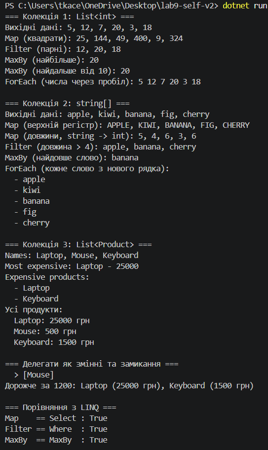
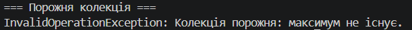

# Самостійна робота №15

**З дисципліни:** Об'єктно-орієнтоване програмування
**Тема:** Делегати й лямбда-вирази: власні утиліти для колекцій
**Виконав:** студент Ткаченко Максим

---

## 1. Мета роботи

Поглибити розуміння делегатів та лямбда-виразів через створення власних узагальнених методів-утиліт для роботи з колекціями та повторного використання логіки.

## 2. Структура проєкту

- `lab9-self-v2.csproj` — файл проєкту (.NET 8).
- `CollectionUtils.cs` — статичний клас з чотирма узагальненими методами.
- `Product.cs` — клас `Product (Name, Price)` для демонстрації.
- `Program.cs` — демонстрація методів на різних колекціях.
- `.gitignore` — виключає службові файли .NET, VS Code та ОС.

## 3. Реалізовані методи

| Метод | Делегат | Призначення | Аналог LINQ |
|-------|---------|-------------|-------------|
| `Map<TSource, TResult>` | `Func<TSource, TResult>` | Перетворює кожен елемент | `Select()` |
| `MaxBy<T, TKey>` | `Func<T, TKey>`, `where TKey : IComparable<TKey>` | Елемент з максимальним значенням ключа | `MaxBy()` (.NET 6+) |
| `Filter<T>` | `Predicate<T>` | Елементи, що задовольняють умову | `Where()` |
| `ForEach<T>` | `Action<T>` | Виконує дію для кожного елемента | немає для `IEnumerable<T>` (є лише `List<T>.ForEach`) |

Особливості реалізації:

- Усі методи перевіряють аргументи на `null` (`ArgumentNullException`).
- `MaxBy` для порожньої колекції кидає `InvalidOperationException` (замість мовчазного повернення `default`, яке для значущих типів дало б хибний результат).
- `Map` і `Filter` виконуються одразу й повертають готовий `List` (на відміну від відкладеного виконання LINQ).

## 4. Демонстрація

Методи викликаються на трьох різних колекціях:

- `List<int>` — квадрати, парні числа, максимум, найдальше від 10, вивід;
- `string[]` — верхній регістр, довжини (`string → int`), слова довші за 4 символи, найдовше слово;
- `List<Product>` — імена, найдорожчий продукт, продукти дорожчі за 1000 (приклад із методички).

Додатково показано делегати у змінних (`Func`, `Predicate`, `Action`), ланцюжок `Filter → Map → ForEach`, лямбду із замиканням (`threshold`), порівняння результатів з LINQ та поведінку на порожній колекції.

## 5. Приклад виводу програми


```
=== Колекція 1: List<int> ===
Вихідні дані: 5, 12, 7, 20, 3, 18
Map (квадрати): 25, 144, 49, 400, 9, 324
Filter (парні): 12, 20, 18
MaxBy (найбільше): 20
MaxBy (найдальше від 10): 20
ForEach (числа через пробіл): 5 12 7 20 3 18 

=== Колекція 2: string[] ===
Вихідні дані: apple, kiwi, banana, fig, cherry
Map (верхній регістр): APPLE, KIWI, BANANA, FIG, CHERRY
Map (довжини, string -> int): 5, 4, 6, 3, 6
Filter (довжина > 4): apple, banana, cherry
MaxBy (найдовше слово): banana
ForEach (кожне слово з нового рядка):
  - apple
  - kiwi
  - banana
  - fig
  - cherry

=== Колекція 3: List<Product> ===
Names: Laptop, Mouse, Keyboard
Most expensive: Laptop - 25000
Expensive products:
  - Laptop
  - Keyboard
Усі продукти:
  Laptop: 25000 грн
  Mouse: 500 грн
  Keyboard: 1500 грн

=== Делегати як змінні та замикання ===
  > [Mouse]
Дорожче за 1200: Laptop (25000 грн), Keyboard (1500 грн)

=== Порівняння з LINQ ===
Map    == Select : True
Filter == Where  : True
MaxBy  == MaxBy  : True

=== Порожня колекція ===
InvalidOperationException: Колекція порожня: максимум не існує.
```

### Скріншот



## 6. Відповіді на запитання до звіту

### Чому делегати є зручним механізмом для передачі поведінки в узагальнений метод?

Метод `Map` знає, **як** обійти колекцію, але не знає, **що** робити з елементом. Делегат передає цю поведінку ззовні, тому один метод працює з будь-яким перетворенням. Без делегатів довелося б писати окремий метод для кожного випадку (`GetNames`, `GetPrices`, `Square`…) або створювати окремі класи з інтерфейсом. Делегат ще й типобезпечний: компілятор перевіряє, що сигнатура поведінки відповідає очікуваній.

### Як лямбда-вирази спрощують виклик цих методів?

Без лямбди для кожного виклику треба було б оголошувати окремий іменований метод:

```csharp
static string GetName(Product p) => p.Name;
var names = CollectionUtils.Map(products, GetName);
```

З лямбдою логіка пишеться прямо в місці виклику: `CollectionUtils.Map(products, p => p.Name)`. Типи параметрів і результату виводяться автоматично, тож не потрібно писати `Map<Product, string>(...)`. Лямбда також може захоплювати локальні змінні (змінна `threshold` у `Filter(products, p => p.Price > threshold)`), чого не вийде зробити зі звичайним статичним методом.

### Порівняння з вбудованими LINQ-операторами

| Моя утиліта | LINQ | Різниця |
|-------------|------|---------|
| `Map` | `Select` | LINQ виконується відкладено (lazy), а `Map` — одразу й повертає `List` |
| `Filter` | `Where` | так само: LINQ відкладений, `Filter` створює новий список одразу |
| `MaxBy` | `Enumerable.MaxBy` | мій метод вимагає `IComparable<TKey>` і завжди кидає виняток на порожній колекції; LINQ-версія на порожній колекції повертає `null` для посилальних типів і кидає виняток для значущих |
| `ForEach` | немає для `IEnumerable<T>` | у LINQ такого оператора навмисно немає (лише `List<T>.ForEach`) |

За семантикою (`Map == Select`, `Filter == Where`) результати збігаються, що перевіряється у програмі через `SequenceEqual`. LINQ додатково дає лінійні ланцюжки, оптимізації та десятки інших операторів, тому на практиці зазвичай використовують його, а власні утиліти корисні для навчання і специфічних випадків.

## 7. Відповіді на контрольні питання

1. **Чому делегати є зручним механізмом для передачі поведінки в узагальнений метод?** Вони дозволяють винести змінну частину алгоритму (що робити з елементом) назовні, залишивши в методі лише спільну частину (обхід колекції). Це усуває дублювання коду й дає типобезпеку.
2. **У чому різниця між `Func<T, TResult>`, `Action<T>` та `Predicate<T>`?** `Func<T, TResult>` приймає параметри й **повертає значення** типу `TResult`. `Action<T>` приймає параметри й **нічого не повертає** (`void`). `Predicate<T>` приймає один параметр `T` і **повертає `bool`** — це умова (за суттю те саме, що `Func<T, bool>`, але з чіткішим змістом і використовується в `List<T>.FindAll`, `RemoveAll` тощо).
3. **Які переваги дає поєднання generic-методів і лямбда-виразів?** Один метод працює з будь-якими типами без дублювання коду; типобезпека на етапі компіляції; відсутність боксингу й приведень типів; автоматичний висновок типів; короткий та читабельний код у місці виклику; можливість замикань.
4. **У яких випадках власні утиліти типу `Map` чи `Filter` корисно реалізовувати самостійно, навіть якщо існує LINQ?** Для навчання (розуміння делегатів та узагальнень); коли потрібна специфічна семантика (негайне виконання, власні винятки, власний порядок обробки); коли оператора немає в LINQ (наприклад, `ForEach` для `IEnumerable<T>`); у проєктах зі старими версіями .NET, де немає частини LINQ-методів (наприклад, `MaxBy` з'явився лише в .NET 6); коли потрібен критичний за продуктивністю код без зайвих алокацій чи залежностей.
